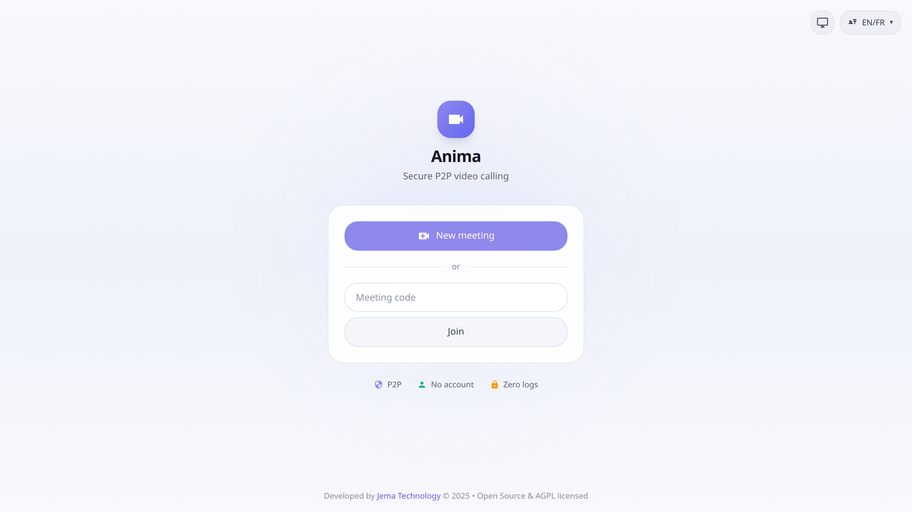
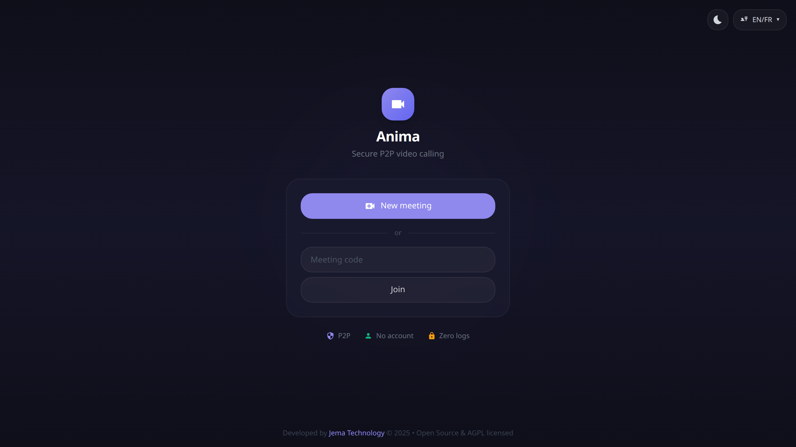

<div align="center">

<h1>📹 Anima</h1>

### Secure, peer-to-peer video calling — no account, no logs

[](https://www.jematechnology.fr)
[](LICENSE)
[](https://react.dev)
[](https://www.typescriptlang.org)
[](https://webrtc.org)
[](https://vitejs.dev)
[](#-getting-started)
[](#-contributing)

**New meeting in one click · join by code · end-to-end encryption · peer-to-peer**

[Features](#-features) · [Screenshots](#-screenshots) · [Getting started](#-getting-started) · [Tech stack](#-tech-stack) · [License](#-license)

</div>



---

## ✨ Features

- 🔐 **End-to-end encryption** for media streams
- 🌐 **Peer-to-peer** — calls connect directly, not through a central server
- 🚪 **No account required** — start or join a room instantly
- 🔑 **Join by code** — share a short meeting code
- 🚫 **Zero logs** — privacy by design
- 🖥️ **Screen sharing** and in-call controls
- 🎨 **Modern UI** built with TailwindCSS, responsive and accessible
- 📶 **Installable PWA** — works offline once installed

---

## 📸 Screenshots

| Light | Dark |
| :---: | :---: |
|  |  |

---

## 🚀 Getting started

### Prerequisites

- [Node.js](https://nodejs.org) 18+
- npm

### Development

```bash
git clone https://github.com/JemaOS/anima.git
cd anima
npm install
npm run dev
```

### Build

```bash
npm run build       # production build
npm run build:prod  # production build (prod mode)
npm run preview     # preview locally
```

### Tests

```bash
npm test            # unit tests (Vitest)
npm run test:e2e    # end-to-end tests (Playwright)
npm run lint        # ESLint
```

---

## 🛠️ Tech stack

- **React 18** + **TypeScript** + **Vite**
- **WebRTC** via `simple-peer` / `peerjs`
- **TweetNaCl** for end-to-end encryption
- **TailwindCSS** + **Radix UI**
- **Vitest** + **Playwright** for tests

---

## 🤝 Contributing

Contributions are welcome! Fork, branch, and open a pull request.

```bash
git checkout -b feat/my-feature
git commit -m "feat: my feature"
git push origin feat/my-feature
```

---

## 📄 License

Released under the **GNU AGPL-3.0** — see [LICENSE](LICENSE).

<div align="center">
Made with ❤️ by <a href="https://www.jematechnology.fr">Jema Technology</a>
</div>
